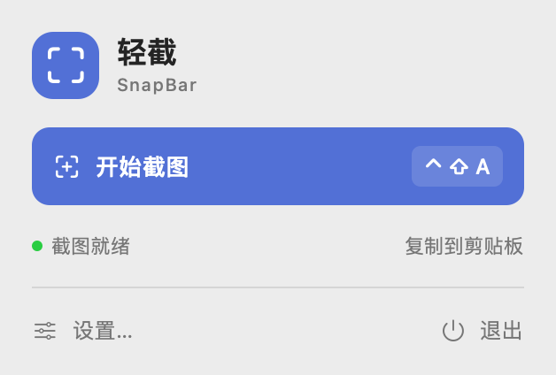
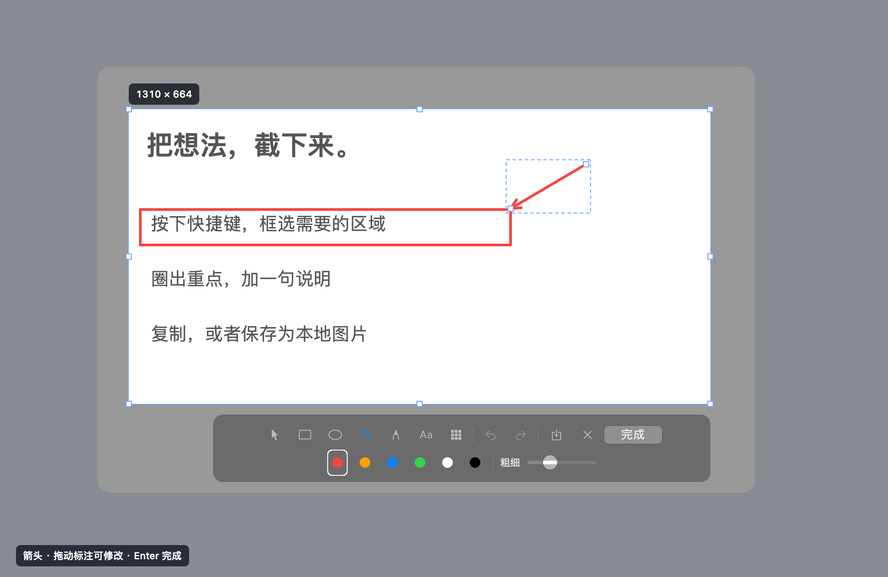
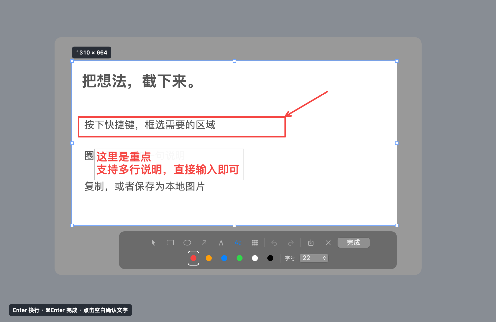

# SnapBar · 轻截

原生 macOS 菜单栏截图与标注工具，支持自定义全局快捷键和本地保存。

A native macOS menu bar app for screenshots, annotations, and local image saving.

使用 Swift、AppKit 和 SwiftUI 构建，无第三方运行依赖。图像在本机处理，无需账号或网络连接。

## 预览

下图由原生界面使用演示内容渲染。





<details>
<summary>多行文字编辑</summary>



</details>

## 功能

- **菜单栏常驻**：点击图标截图或进入设置，不占 Dock。
- **自定义全局快捷键**：默认 Control + Shift + A，注册冲突时保留原组合。
- **框选与标注**：矩形、椭圆、箭头、画笔、文字、马赛克；支持撤销、重做和直接拖动编辑。
- **减少重复设置**：工具条按需显示颜色、粗细、字号，并记住上次使用的样式。
- **本地保存**：PNG/JPG 另存为，或在完成截图时自动保存到指定文件夹。
- **Retina 与多显示器**：按原始屏幕像素导出，可在任意一个显示器上框选。
- **通用设置**：登录启动、完成提示和权限状态。

多显示器截图每次属于一个屏幕；当前不支持跨屏合并、滚动长截图、OCR、录屏或截图历史。

## 下载与安装

**[下载 SnapBar 1.1.0 macOS 安装包（DMG）](https://github.com/danchaofan/snapbar/raw/refs/heads/main/Installers/SnapBar-1.1.0-macOS-universal.dmg)**

要求 **macOS 13 或以上**。安装包同时包含 Intel 和 Apple Silicon 版本，安装和使用无需 Xcode 或其他开发环境。

1. 下载并双击打开 `SnapBar-1.1.0-macOS-universal.dmg`。
2. 将「轻截.app」拖到安装盘里的 **Applications（应用程序）** 文件夹。如果已安装旧版，先退出轻截再替换。
3. 推出安装盘，从「应用程序」打开「轻截」。屏幕顶部菜单栏会出现取景框图标。
4. 首次截图时，在「系统设置 → 隐私与安全性 → 屏幕录制」中允许轻截，按系统提示退出并重新打开。
5. 按 **Control + Shift + A** 开始截图，快捷键可在设置中修改。

当前安装包采用本地临时签名，尚未做 Apple 公证。首次打开若被 macOS 拦截，确认来自本仓库后可右键 App 选择「打开」；较新的 macOS 可在「系统设置 → 隐私与安全性」中选择「仍要打开」。

安装包保存在仓库的 [Installers](Installers/) 目录，[SHA-256 校验值](Installers/SnapBar-1.1.0-macOS-universal.dmg.sha256) 与安装包一同提供。

## 操作

按截图快捷键后拖动框选。八个选区控制点可随时调整大小；使用「选择」工具可移动选区。标注画完后，直接拖动轮廓可移动，拖动控制点可修改大小或箭头方向。

| 操作 | 快捷键或方式 |
| --- | --- |
| 开始截图 | Control + Shift + A，可在设置中修改 |
| 完成并复制 | Enter 或工具条「完成」 |
| 另存为本地文件 | Command + S 或保存按钮 |
| 取消截图 | Esc 或右键 |
| 撤销 / 重做 | Command + Z / Command + Shift + Z |
| 删除选中的标注 | Delete |
| 选择 / 矩形 / 椭圆 | V / R / O |
| 箭头 / 画笔 / 文字 / 马赛克 | A / P / T / M |
| 约束正方形、圆形或箭头角度 | 绘制时按住 Shift |
| 退出当前标注工具 | 再次点击当前工具 |

文字工具支持 **Enter 换行、Command + Enter 完成截图**。点击空白可确认文字；已有文字单击编辑、拖动移动。

开启「复制并自动保存」后，完成截图会同时写入默认文件夹。手动另存为也会先复制，取消保存时图片仍在剪贴板。保存失败会提供另存为入口。

## 设置

点击菜单栏面板的「设置…」，可修改截图快捷键、完成后的行为、保存文件夹、PNG/JPG 格式、登录启动和完成提示。JPG 使用 92% 质量。

默认保存到桌面，文件名包含日期、时间及毫秒。同名时添加随机后缀，自动保存不会覆盖已有截图。菜单栏面板可定位最近一次保存的文件。

## 构建

需要 Xcode Command Line Tools。本项目已在 **macOS 13.3.1 / Swift 5.8.1 / macOS 13.3 SDK（Intel）** 上构建和验证；Apple Silicon 产物已交叉编译，尚未进行实机验证。其他 SDK 组合尚未验证。

```bash
git clone https://github.com/danchaofan/snapbar.git
cd snapbar
./build.sh
```

输出为 `dist/轻截.app`。图标由 `MakeIcon.swift` 自动生成。

```bash
# 同时构建 Intel 和 Apple Silicon 通用版本
SNAPBAR_ARCH=universal ./build.sh
```

可通过 `SNAPBAR_ARCH=arm64` 或 `SNAPBAR_ARCH=x86_64` 指定单一架构。`SNAPBAR_OUTPUT_DIR` 和 `SNAPBAR_BUILD_DIR` 可修改输出与缓存位置。

### 打包 DMG 安装盘

```bash
SNAPBAR_ARCH=universal ./build.sh
./package-dmg.sh
```

默认将 `dist/轻截.app` 打包到 `Installers/`，同时生成 SHA-256 校验文件。安装盘包含 App、Applications 快捷入口和安装说明。

也可以指定已有的 App 和输出目录，打包过程保留 App 现有签名：

```bash
./package-dmg.sh '/path/to/轻截.app' './Installers'
```

## 验证与界面预览

```bash
./dist/轻截.app/Contents/MacOS/SnapBar --self-test
./dist/轻截.app/Contents/MacOS/SnapBar --interaction-test
```

当前在本机通过 25 项图片与文件检查，以及 29 项原生交互检查。覆盖像素裁切、标注合成、PNG/JPG 编解码、本地写入、直接编辑、多行文本、快捷键注册冲突和设置重新加载。交互检查向 App 自身的视图传递事件，不控制其他应用，也不改写剪贴板。

以下命令使用演示图像渲染原生界面，不读取真实屏幕内容：

```bash
./dist/轻截.app/Contents/MacOS/SnapBar --render /tmp/snapbar-menu.png
./dist/轻截.app/Contents/MacOS/SnapBar --render /tmp/snapbar-settings.png --settings
./dist/轻截.app/Contents/MacOS/SnapBar --render /tmp/snapbar-capture.png --capture
./dist/轻截.app/Contents/MacOS/SnapBar --render /tmp/snapbar-text.png --text-editor
```

追加 `--dark` 可渲染深色外观。

## 屏幕录制权限问题

本地重新构建会改变临时签名，可能导致旧授权不再匹配当前 App。若已经开启权限仍重复出现「允许轻截读取屏幕」：

1. 确认运行的是「应用程序」中的同一份轻截，退出后重新打开。
2. 若仍异常，退出轻截，在终端仅重置此 App 的屏幕录制权限：

   ```bash
   tccutil reset ScreenCapture com.local.SnapBar
   ```

3. 重新打开轻截，在系统设置中允许「轻截」。若列表没有它，使用「＋」添加「应用程序 → 轻截」，再按系统提示重启 App。

该操作保留快捷键、保存设置和已有截图。默认应用标识为 `com.local.SnapBar`；修改应用标识时需相应调整命令。

## 源码结构

| 文件 | 用途 |
| --- | --- |
| `Sources/App.swift` | 菜单栏、权限引导、复制与保存交互 |
| `Sources/Core.swift` | 偏好设置、Carbon 全局快捷键、图像编码与文件写入 |
| `Sources/Capture.swift` | 多屏截图窗口、框选、标注与文字编辑 |
| `Sources/Rendering.swift` | 像素坐标、裁切与标注合成 |
| `Sources/Views.swift` | 菜单栏面板和设置界面 |
| `Sources/Diagnostics.swift` | 图片与文件自测、原生界面渲染 |
| `Sources/InteractionTests.swift` | 原生事件、系统快捷键和偏好设置检查 |

屏幕图像在内存中处理，只有手动保存或开启自动保存后才会写入选定文件夹。导出图片会合并全部标注，马赛克不携带可撤回的编辑图层。

更新记录见 [CHANGELOG.md](CHANGELOG.md)。

## License

[MIT](LICENSE) © 2026 SnapBar contributors
